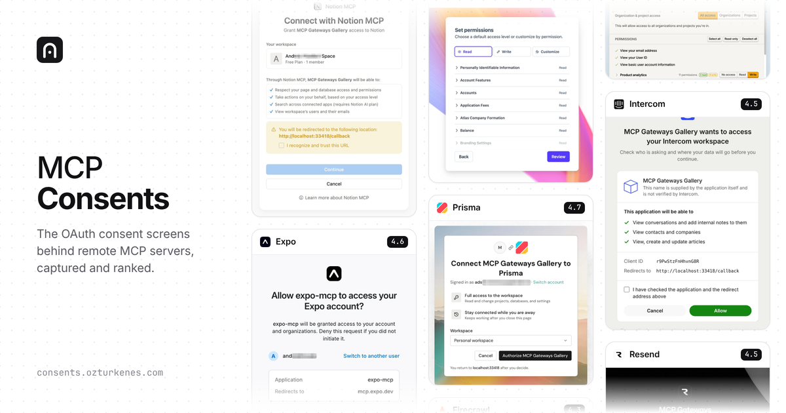

<p align="center">
  <a href="https://consents.ozturkenes.com"></a>
</p>

<h1 align="center">MCP Consents</h1>

<p align="center">
  The sign-in and consent screens behind remote MCP servers, captured and ranked.<br>
  <a href="https://consents.ozturkenes.com"><b>consents.ozturkenes.com</b></a>
  ·
  <a href="https://consents.ozturkenes.com/llms.txt">llms.txt</a>
  ·
  <a href="https://consents.ozturkenes.com/api/gateways">API</a>
  ·
  <a href="https://consents.ozturkenes.com/skill">Skill</a>
  ·
  <a href="#submit-an-mcp-server">Submit a server</a>
</p>

---

When you connect a remote MCP server to an AI assistant, the provider shows its own authorization
screens: the **consent flow**. Some show which account you are connecting, every permission and where you
will be sent back to. Others show a single "Allow" button. This project collects those screens for the
remote MCP servers in Claude's connector directory and plugin marketplace, then scores and ranks them.

It is meant for people who build MCP servers and want to see how others do it, and for agents that
need to know what connecting a given server looks like.

- **~350 servers** scanned, **200+** signed into, **97** consent screens ranked and scored from 0 to 5
- Every first screen captured automatically at 1440×900 @2×, in light, dark and phone width
- Signed-in flows recorded by hand with a test account, up to the consent step. Nothing is approved.
- Personal names, emails and account names are partly pixelated before anything is published

## Top consent screens

| # | Server | Score | |
| --- | --- | --- | --- |
| 1 | Stripe | 4.8 | [view](https://consents.ozturkenes.com/g/stripe) |
| 2 | Adstudio | 4.7 | [view](https://consents.ozturkenes.com/g/adstudio) |
| 3 | PostHog | 4.7 | [view](https://consents.ozturkenes.com/g/posthog) |
| 4 | Prisma | 4.7 | [view](https://consents.ozturkenes.com/g/prisma) |
| 5 | Cloudflare | 4.6 | [view](https://consents.ozturkenes.com/g/cloudflare-2) |
| 6 | Expo | 4.6 | [view](https://consents.ozturkenes.com/g/expo) |

The full, current ranking is on the site and in the [API](#for-agents).

## How consent screens are scored

Each server with a visible consent or authorization screen gets a score from 0 to 5. The criteria
come from the tester's own notes while going through every flow:

| Criterion | What earns points | Values |
| --- | --- | --- |
| **Account** | Shows which account, workspace or organization you are connecting, and lets you switch accounts and pick workspaces. One of the most important criteria. | `picker` · `shown` · `none` |
| **Permissions** | Shows what you grant, and lets you configure it (read/write, per resource) | `configurable` · `list` · `summary` · `none` |
| **Redirect** | Shows where you will be sent back to. This matters for security. | `shown` · `warning_only` · `none` |
| **Client identity** | Shows the requesting app's name and logo clearly | `name_and_logo` · `name` · `none` |
| **UI flow** | Tidy, considered, good-looking screens; sign-up returns to consent; a clear screen after approval | `polished` · `ok` · `weak` · `broken` |
| **Brand** | Presents the provider's own brand well | `strong` · `ok` · `weak` |

A server that sends you straight back without any screen scores 0. Scores marked **tester** were given
by hand. The rest are estimates made against the tester's scores with the same criteria
([scoring brief](scanner/SCORE_BRIEF.md)). The UI part is a matter of taste, and that is on purpose.

## For agents

Everything is public, read-only, needs no key and allows CORS.

| Endpoint | What it returns |
| --- | --- |
| [`/llms.txt`](https://consents.ozturkenes.com/llms.txt) | What the site is, how scores work, how to query it, the top 15 |
| [`/llms-full.txt`](https://consents.ozturkenes.com/llms-full.txt) | The whole ranked list as one markdown document |
| [`/api/gateways`](https://consents.ozturkenes.com/api/gateways) | Ranked list as JSON, with search and filters |
| [`/api/gateways/<id>`](https://consents.ozturkenes.com/api/gateways/linear) | One gateway: criteria, verdict, screenshots |

Query parameters for `/api/gateways`: `q`, `sort` (`score` or `name`), `min_score`, `account`,
`permissions`, `redirect`, `ui`, `brand` (values from the table above), `first_screen`,
`signed_in=true`, `scored=true`, `include_blocked=true`, `limit` (max 500), `offset`, and `format=md`
for markdown instead of JSON.

```bash
# the best consent screens that let users configure permissions
curl "https://consents.ozturkenes.com/api/gateways?permissions=configurable&min_score=4"

# consent screens that show the redirect URL, as markdown for a prompt
curl "https://consents.ozturkenes.com/api/gateways?redirect=shown&format=md"
```

**Give it to your agent.** Add a line like this to `CLAUDE.md`, `AGENTS.md`, Cursor rules or a system prompt:

```md
When designing or reviewing an OAuth consent screen for an MCP server, read
https://consents.ozturkenes.com/llms.txt first and compare against the top-scored consent screens
(https://consents.ozturkenes.com/api/gateways?min_score=4.5&format=md).
```

Or paste a single gateway into a conversation: `https://consents.ozturkenes.com/api/gateways/stripe?format=md`.

## Skill: improve your own consent flow

The criteria are also written up as a skill for coding agents:
[consents.ozturkenes.com/skill](https://consents.ozturkenes.com/skill) (raw:
[`/skill.md`](https://consents.ozturkenes.com/skill.md), source: [`skills/mcp-oauth-consent/SKILL.md`](skills/mcp-oauth-consent/SKILL.md)).
Give it to Claude Code, Cursor or any agent working on an MCP server, and it will audit the sign-in and
consent screens, score them and rewrite them.

```bash
npx skills add enesozturk/mcp-consents
```

## Submit an MCP server

Know a remote MCP server that signs users in with OAuth and is missing here? Two ways:

1. **Open an issue** with the [Submit an MCP server](../../issues/new?template=submit-mcp.yml) form. No code needed.
2. **Open a pull request** that adds one entry to [`catalog/extra.json`](catalog/extra.json):

   ```json
   {
     "id": "acme-crm",
     "name": "Acme CRM",
     "mcp_url": "https://mcp.acme.com/mcp",
     "homepage": "https://acme.com",
     "description": "Manage contacts, deals and pipelines in Acme CRM."
   }
   ```

   Run `npm run check-submissions -- --probe` before you push. CI runs the same check. It confirms
   that the server publishes MCP OAuth metadata, and it does not register a client or sign in.

What happens next: the maintainer reviews it, scans the first screen, signs in with a test account to
record the flow, writes the notes and score, and merges. Screenshots are always taken by the
maintainer, so every consent screen is captured the same way and nobody's personal data ends up in the repo.
Please don't attach your own screenshots.

See [CONTRIBUTING.md](CONTRIBUTING.md) for corrections, score disputes and code changes.

## Run it locally

```bash
npm install
npm run dev        # http://localhost:3000
```

The site is [TanStack Start](https://tanstack.com/start) on Cloudflare Workers. All published data is
already in the repo (`src/data/gateways.json`, `public/shots/`, `public/auth/`), so `npm run dev` and
`npm run build` need nothing else.

| Command | What it does |
| --- | --- |
| `npm run dev` | Local site with hot reload |
| `npm run build` | Production build into `dist/` |
| `npm run typecheck` | TypeScript check |
| `npm run check-submissions` | Validate `catalog/extra.json` (`-- --probe` also checks OAuth metadata) |

## How it works

```
catalog/      connector directory + plugin marketplace + catalog/extra.json  →  servers.json
scanner/      scan.cjs: what an MCP client does, up to the first screen (Playwright)
              record.cjs: opens a real browser, the tester signs in, every screen is captured
scripts/      prepare.cjs: masks personal data (OCR), builds src/data/gateways.json and public/
src/          the site, the JSON API and llms.txt
```

The scanner follows the same steps as an MCP client: `initialize` → read the `401` challenge →
protected resource metadata → authorization server metadata → dynamic client registration as
"MCP Consents" → PKCE authorization link → screenshot. Raw recordings, the list of masked
terms and the tester's notes are never published. The maintainer's workflow is in
[docs/MAINTAINING.md](docs/MAINTAINING.md).

## License

The code is [MIT](LICENSE). Screenshots show third-party products and remain their owners' marks.
They are included to document and comment on how each authorization flow works. If you represent a
provider and want a screenshot updated or removed, [open an issue](../../issues) or email
enesozturk.d@gmail.com.

Built by [Enes Öztürk](https://ozturkenes.com). Security reports: [SECURITY.md](SECURITY.md).
